# TP Final — Pipeline medallion con Transfermarkt

Nombre: Maximiliano Fronciani

student_id: maxi_fronciani

Variante 2, opción A: arquitectura medallion (Bronze, Silver y Gold) orquestada con Databricks Pipelines (Lakeflow Declarative Pipelines).

## Objetivo

Armar un pipeline que tome los datos de fútbol de Transfermarkt tal como vienen, los limpie y valide con controles de calidad, y genere tablas finales para responder preguntas sobre jugadores, clubes, ligas y el mercado de pases.

## Datos

Fuente: Transfermarkt Datasets (github.com/dcaribou/transfermarkt-datasets), licencia CC0. Son 7 archivos CSV comprimidos con datos desde la temporada 2012:

| Archivo | Filas | Contenido |
|---|---|---|
| competitions | 65 | ligas y copas |
| clubs | 796 | clubes |
| players | 50.149 | jugadores |
| games | 88.958 | partidos |
| appearances | 1.894.350 | participación de cada jugador en cada partido |
| player_valuations | 656.301 | historia del valor de mercado |
| transfers | 175.165 | transferencias entre clubes |

## Contenido de la carpeta

- notebooks/00_descarga_datos.ipynb: crea el schema workspace.tp_transfermarkt y el volumen raw, descarga los 7 archivos y tiene las consultas usadas para revisar los controles de calidad.
- pipeline/01_bronze.py, 02_silver.py, 03_gold.py: el código del pipeline, una capa por archivo.
- notebooks/04_analisis_gold.ipynb: reconciliación entre capas y análisis sobre las tablas Gold.
- notebooks/05_analisis_extra.ipynb: tres análisis más (inflación del mercado, efecto de ser transferido y gasto contra títulos).
- capturas/: el grafo del pipeline y los gráficos.

## Cómo reproducirlo

1. Importar y correr notebooks/00_descarga_datos.ipynb con Serverless. Deja los archivos en /Volumes/workspace/tp_transfermarkt/raw/transfermarkt/.
2. Crear un pipeline nuevo (Jobs & Pipelines → Create → ETL Pipeline) con catálogo workspace y schema tp_transfermarkt, y poner los tres archivos de pipeline/ dentro de la carpeta transformations.
3. Correr el pipeline. Genera las 18 tablas.
4. Importar y correr los notebooks 04 y 05.

## Modelado

Bronze guarda una copia fiel de cada CSV: todas las columnas como texto, sin limpiar, más dos columnas de trazabilidad (_source_file con el archivo de origen y _ingested_at con el momento de carga). Así, si hay un error en una regla, se puede volver a procesar sin descargar los datos de nuevo.

Silver tipa las columnas con try_cast (si un valor no se puede convertir queda NULL en vez de romper el pipeline), elimina duplicados por la clave de cada tabla y aplica los controles de calidad. Cada tabla Silver mantiene el grano de su archivo original: una fila por competición, club, jugador, partido, participación, valuación o transferencia.

Gold tiene cuatro tablas pensadas para preguntas concretas:

| Tabla | Grano | Qué tiene |
|---|---|---|
| gold_player_season_stats | un jugador por temporada | partidos, minutos, goles, asistencias, tarjetas y goles cada 90 minutos |
| gold_player_market_value | un jugador | último valor de mercado, valor máximo, cantidad de valuaciones y edad |
| gold_club_transfer_balance | un club por temporada de pases | gasto, ingresos, altas, bajas y balance |
| gold_competition_season | una competición por temporada | partidos, goles promedio, % de victorias local, empate y visitante, y asistencia promedio |

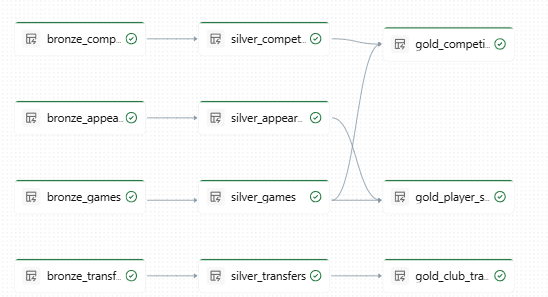

## Calidad de datos

Los controles se hicieron con expectations del pipeline. Las reglas de tipo drop descartan la fila que no cumple; las de tipo warn la dejan pasar pero queda registrado cuántas fallaron.

| Tabla | Regla | Tipo | Filas que fallaron |
|---|---|---|---|
| silver_competitions | competition_id presente | drop | 0 |
| silver_clubs | club_id presente | drop | 0 |
| silver_clubs | capacidad del estadio mayor a 0 | warn | 1 |
| silver_players | player_id presente | drop | 0 |
| silver_players | altura entre 140 y 220 cm | warn | 13 |
| silver_players | valor de mercado no negativo | warn | 0 |
| silver_games | game_id presente, fecha válida y goles no negativos | drop | 0 |
| silver_games | local y visitante distintos | warn | 0 |
| silver_appearances | ids presentes, minutos entre 0 y 150 y estadísticas no negativas | drop | 0 |
| silver_player_valuations | jugador y fecha presentes, valor mayor a 0 | drop | 1 |
| silver_transfers | jugador y fecha presentes | drop | 0 |
| silver_transfers | monto no negativo | warn | 0 |

La fila descartada en player_valuations es una valuación de 0 euros (player_id 60096, 17/03/2008, NK Maribor). Las 13 alturas fuera de rango van de 17 a 19 cm, así que lo más probable es que se haya cargado la edad en el campo de altura. El club con capacidad 0 es Deportivo Pereira. Estas filas se conservaron porque el resto de sus datos sirve.

En el grafo se ven estas marcas sobre cada tabla:

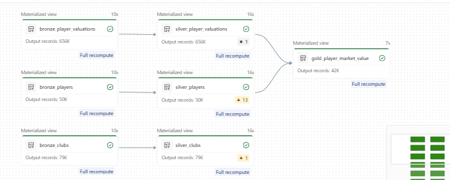

Reconciliación entre capas: seis de las siete tablas pasan de Bronze a Silver con la misma cantidad de filas. La única diferencia es player_valuations, con 656.301 filas en Bronze y 656.300 en Silver, que es justamente la fila descartada.

## Resultados

### Jugadores más valiosos

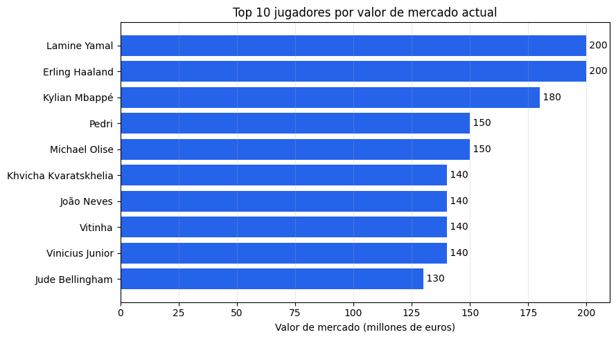

Haaland y Lamine Yamal encabezan con 200 millones cada uno, y Yamal tiene solo 18 años. Del top 10, seis son delanteros y cuatro mediocampistas: no hay ningún defensor ni arquero. Además se concentran en pocos clubes: PSG y Real Madrid tienen tres jugadores cada uno y Barcelona dos.

### Evolución de Haaland

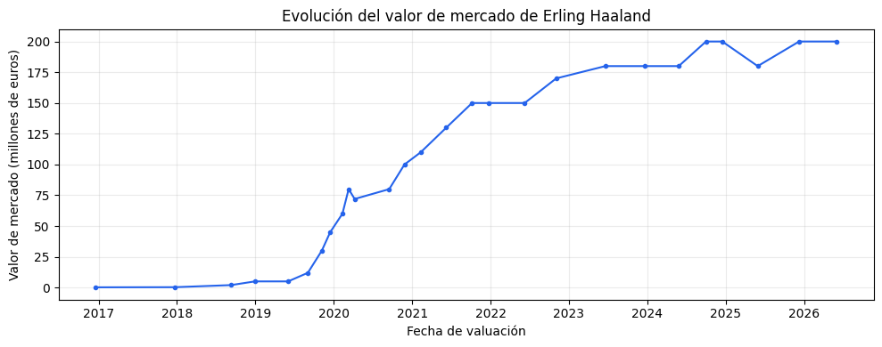

Hasta mediados de 2019 valía menos de 10 millones. Entre 2019 y 2020 su valor se multiplica de golpe, que coincide con su paso por el Salzburgo y la llegada al Dortmund. Pasa los 100 millones a fines de 2020 y llega a 200 en 2024. Desde ahí se mantiene cerca de ese techo, con una baja a 180 en 2025.

### Clubes y transferencias

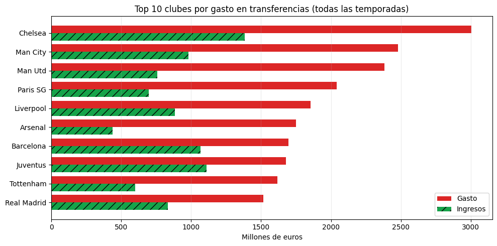

Los 10 clubes que más gastaron tienen balance negativo: gastaron más de lo que ingresaron por ventas. Seis de ellos son ingleses. Chelsea es el que más gastó, unos 3.000 millones, pero el peor balance es el del Manchester United, con -1.625 millones, casi igual que Chelsea. Juventus y Barcelona son los que mejor compensan con ventas, con los déficits más chicos (alrededor de -570 y -630 millones). Arsenal es el que menos ingresó, 438 millones.

### Las 5 grandes ligas

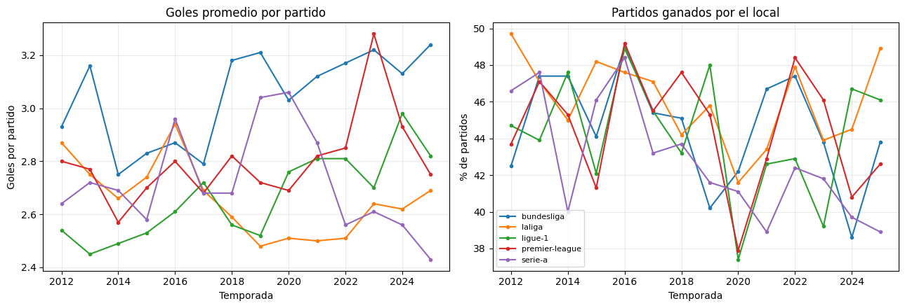

La Bundesliga es la liga con más goles: desde 2018 promedia más de 3 por partido todas las temporadas. LaLiga es la que menos convierte en los últimos años, entre 2,5 y 2,7. Serie A bajó de 3,06 en 2020 a 2,43 en 2025, y la Premier tuvo su pico en 2023 con 3,28.

Lo más llamativo es la temporada 2020, que se jugó sin público por la pandemia. La asistencia promedio cayó de 20.000–40.000 a menos de 5.000, y el porcentaje de victorias locales tocó su mínimo en casi todas las ligas. En la Premier ganaron más los visitantes (40,3%) que los locales (37,9%), y en la Ligue 1 quedaron casi iguales (37,6% contra 37,4%). Esto sugiere que buena parte de la ventaja de local viene del público.

Dos aclaraciones del dato: la Ligue 1 2019 tiene solo 279 partidos porque la temporada se suspendió por el COVID, y desde 2023 tiene 306 porque la liga pasó a 18 equipos.

### Goleadores de la última temporada

Harry Kane es el goleador de 2025, con 64 goles en 58 partidos. Lo siguen Mbappé con 47 y Haaland con 45. Kane y Mbappé son los únicos que superan un gol cada 90 minutos (1,25 y 1,05). Después de los tres primeros hay un salto grande, porque el cuarto tiene 34 goles. Los números incluyen todas las competiciones del dataset (liga, copas y torneos europeos), por eso son más altos que los de una sola liga. Olise es el más completo, con 25 goles y 36 asistencias, por lejos el que más asistencias tiene de la lista. Ninguno de los 15 fue expulsado en toda la temporada.

### Inflación en el mercado de pases

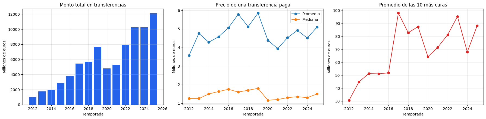

El monto total en transferencias pasó de 1.003 millones en 2012 a 12.116 millones en 2025, unas 12 veces más. Pero ese crecimiento viene sobre todo de la cantidad de operaciones: las transferencias pagas pasaron de 281 a 2.375. Parte de eso puede ser que el dataset registra más movimientos en las temporadas recientes. El precio de un pase típico casi no cambió: comparando 2012–2014 con las últimas 3 temporadas, el promedio subió un 15% y la mediana solo un 4%, de 1,33 a 1,38 millones. Donde sí hay inflación es arriba de todo: el promedio de los 10 pases más caros de cada temporada se duplicó, de 42 a 84 millones. El gran salto fue en 2017, el año de Neymar al PSG por 222 millones. El COVID se nota en 2020: el total cae de 7.660 a 4.809 millones y la mediana baja a 1,16.

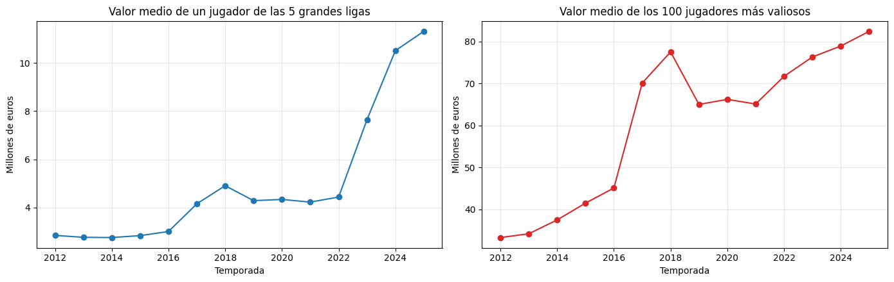

Con los valores de mercado pasa algo parecido. El valor medio del top 100 subió de 33 a 82 millones. El valor medio de un jugador de las 5 grandes ligas pasó de 2,85 a 11,3 millones, pero casi todo ese salto se da entre 2022 y 2025, de 4,4 a 11,3. Ese salto conviene tomarlo con cuidado, porque puede deberse a qué jugadores tienen valuaciones cargadas esas temporadas y no a una suba real.

### ¿Al jugador le conviene ser transferido?

Se compararon pares de temporadas consecutivas de jugadores que jugaron al menos 900 minutos en la primera. Los que se fueron en el mercado de verano se separaron de los que se quedaron en su club, que sirven como grupo de control.

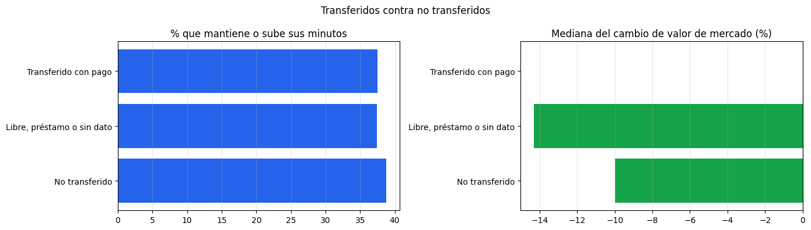

En minutos y en rendimiento, ser transferido no cambia mucho. En los tres grupos los minutos bajan de una temporada a la otra; es esperable, porque se eligieron jugadores que ya venían jugando mucho. El porcentaje que mantiene o sube sus minutos es casi igual: 38,8% de los que se quedan, 37,5% de los transferidos con pago y 37,4% de los libres o préstamos. Los goles más asistencias cada 90 minutos tampoco cambian de forma importante en ningún grupo.

La diferencia está en el valor de mercado. Para la mediana de los que se quedan en su club, el valor cae un 10%. Para los que se van libres o a préstamo cae un 14%. Para la mediana de los transferidos con pago no cambia (0%). Hay que tener en cuenta que los transferidos con pago son más jóvenes (24,9 años contra 27,3), así que parte de esa diferencia puede ser por edad y no por el pase.

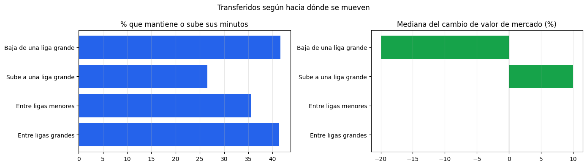

Lo más interesante sale al mirar hacia dónde se mueven. Los que suben a una liga grande pierden lugar: solo el 26,6% mantiene sus minutos, y su producción cae de 0,32 a 0,24 goles más asistencias cada 90 minutos. Aun así, la mediana de su valor de mercado sube un 10%. Los que bajan de una liga grande pasan lo contrario: juegan más (41,6% mantiene o sube minutos) y su producción sube de 0,22 a 0,30, pero la mediana de su valor baja un 20%. O sea, el mercado parece valorar más la liga en la que juega el jugador que lo que rinde.

Una limitación: si un jugador se va a una liga que el dataset no sigue, no aparece la temporada siguiente y queda fuera del análisis.

### ¿El club que más gasta sale campeón?

El dataset no tiene una tabla de títulos, así que la tabla de posiciones de cada liga se armó a partir de los partidos (3 puntos por victoria, 1 por empate, desempate por diferencia de gol), solo para las 5 grandes ligas y las temporadas completas. No se tuvieron en cuenta las quitas de puntos por sanciones.

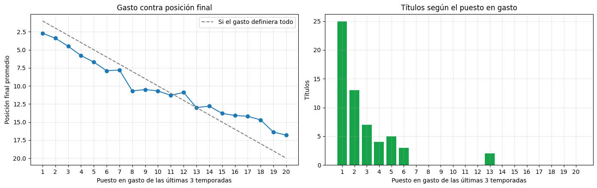

Se analizaron 59 campeonatos de las 5 grandes ligas entre 2014 y 2025. Mirando solo el gasto de esa temporada, el campeón fue el que más gastó en el 35,6% de los casos, y estuvo entre los 3 que más gastaron en el 67,8%. Si se mira el gasto acumulado de las últimas 3 temporadas, la relación es más fuerte: 42,4% y 76,3%. Tiene sentido, porque un plantel se arma en varios mercados. En el gráfico se ve que, cuanto más alto está un club en gasto, mejor termina en promedio en la tabla.

La correlación entre el puesto en gasto y la posición final es de 0,59 si se mira el gasto de la temporada y de 0,70 si se miran las últimas 3. Es una relación fuerte pero no total. La liga donde más pesa el gasto es la Serie A, con 0,80. La que menos es la Premier: 0,48 con el gasto de la temporada, aunque sube a 0,68 con el de 3 temporadas. Tiene sentido, porque en la Premier casi todos los clubes gastan mucho, entonces gastar más que el resto marca menos diferencia. En todas las ligas el gasto acumulado de 3 temporadas explica mejor la posición que el gasto de un solo año.

Gastar mucho ayuda, pero no garantiza nada. Casi todos los campeones estaban entre los 6 que más gastaron en las 3 temporadas anteriores. Las excepciones fueron dos, ambas en el puesto 13: Leicester en 2015, con solo 49,5 millones, y Liverpool en 2024. Chelsea es el que más gastó de todos (2.753 millones) y ganó solo 2 ligas, y el Manchester United no ganó ninguna. El Bayern ganó 11 de 12 Bundesligas gastando 1.029 millones, menos de la mitad que Chelsea, porque en su liga es claramente el que más gasta. Al PSG le pasa lo mismo en Francia: fue el que más gastó casi todos los años y ganó 9 títulos.
