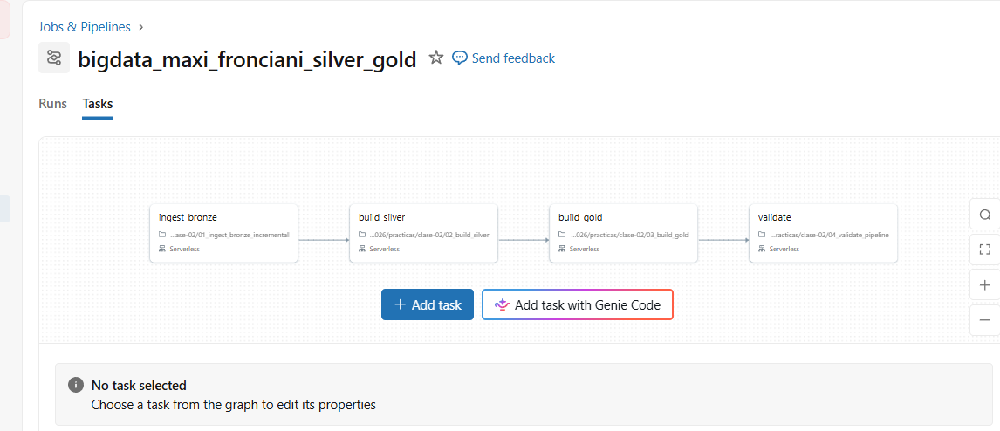

# Practica 2 - Silver, Gold y orquestacion

Nombre: Maxi Fronciani
student_id: maxi_fronciani

## Job

Nombre del Job: bigdata_maxi_fronciani_silver_gold



## Resultados de la primera y segunda ejecucion

| job_run_id | expected_batch_id | silver_rows | quarantine_rows | gold_rows | gold_total_amount | idempotence_compared |
|---|---|---|---|---|---|---|
| 392746772543157 | batch_002 | 50149 | 53 | 598 | 50286183.33 | false |
| 481363985074196 | batch_002 | 50149 | 53 | 598 | 50286183.33 | true |
| 323352184013810 | batch_003 | 50349 | 55 | 669 | 50431198.33 | false |

Las dos ejecuciones de batch_002 dieron las mismas metricas. La segunda tiene idempotence_compared en true.

## batch_002: aceptadas y rechazadas

Aceptadas: 200. Rechazadas: 2.

En la primera corrida batch_002 tenia 201 aceptadas. Paso a 200 cuando llego batch_003, porque la transaccion 42 quedo con la version de batch_003.

## COPY INTO y MERGE

COPY INTO trabaja con archivos: no vuelve a cargar un archivo que ya cargo. MERGE trabaja con transacciones: inserta las nuevas y actualiza las que llegan con una version mas reciente, sin duplicar.

## Grano de las tablas Gold

- gold_daily_sales: una fila por dia, pais, categoria y canal de pago.
- gold_customer_risk: una fila por cliente.
- gold_batch_summary: una fila por lote.

## Visualizaciones

Los graficos estan en 05_visualizacion.ipynb.

### Consigna 1 - Evolucion temporal

Las salidas nos muestran que en ambos casos el dia de mayor facturacion coincide con el de mas trasacciones. (01/03/2026). A su vez el ticket promedio nos brinda una informacion adicional, y es que gracias a que fue el dia de mayor cantidad de transacciones se logró ser el dia de mayor facturación, ya que el dia de mayor ticket promedio fue el 02/03/2026 (teniendo un 0,2% de mayor facturacion en promedio)

### Consigna 2 - Canal y fraude

El dato crudo nos muestra que las transferencias es el canal donde encontramos mas transacciones fraudulentas (2.327); a su vez si bien es el canal con menor cantidad de transacciones (16.723), tan solo es menor en 0,006% frente a wallet y 1,07% a tarjeta. En la definicion de tasa de fraude por canal vemos que transferencias muestra el mayor porcentaje con casi un 14%.

### Consigna 3 - Pais y categoria

El grafico nos muestra que el mayor volumen facturado lo tenemos en Brasil en la division de "home". Si bien en cada pais este sector tiene una facturacion proponderante en el general, no es el mayor en todos los casos. En Argentina y Mexico observamos que la division "books" es la que genera un mayor nivel de facturacion.

El formato del grafico me parece adecuado ya que nos permite ubicar a simple vista cuales son las combinaciones de paises y divisiones que generan mayor nivel de facturacion y aquellas otras que lo hacen en niveles inferiores. A su vez ajustamos poniendo los paises que mas facturan arriba y los que menos abajo, y las divisiones que mas lo hacen a la izquieras y a la derecha la que menos. Una nota rapidamente cual es, por ejemplo la division y pais que genera una mayor facturacion debido al color azul oscuro que produce, y a la inversa en los colores claros.

### Consigna 4 - Calidad por lote

Podemos observar que en terminos totales hemos tenido 55 rechazos, siendo 51 del inicial y 4 en los nuevos lotes (2 en cada uno). Si lo planteamos en terminos porcentuales podemos decir que los nuevos lotes tienen practicamente 10 veces mas rechazo que el inicial y deberiamos contemplar algunanalisis de estos rechazos, pero a su vez, si lo vemos en valores totales, al ser una muestra radicalmente mas chica nos cesga el resultado porcentual (1 solo rechazo en los nuevos lotes son 5 veces en proporcion al inicial). Concluyo que hay que analisir el global en todas las situaciones, no siempre enfocarse en la tasa sino tambien a veces en los valores absolutos.

## Preguntas de analisis y comprension

### 1

```sql
SELECT source_batch_id, count(*) AS filas
FROM bronze_transactions_incremental
GROUP BY source_batch_id ORDER BY source_batch_id
```

| source_batch_id | filas |
|---|---|
| batch_002 | 204 |
| batch_003 | 204 |

Cada lote recibio 204 filas fisicas.

### 2

```sql
SELECT source_batch_id, count(*) AS aceptadas
FROM silver_transactions GROUP BY source_batch_id ORDER BY source_batch_id;

SELECT source_batch_id, count(*) AS rechazadas
FROM silver_transactions_quarantine GROUP BY source_batch_id ORDER BY source_batch_id;

SELECT source_batch_id, accepted_transactions, rejected_transactions
FROM gold_batch_summary ORDER BY source_batch_id;
```

| source_batch_id | aceptadas | rechazadas | gold_batch_summary |
|---|---|---|---|
| batch_002 | 200 | 2 | 200 / 2 |
| batch_003 | 201 | 2 | 201 / 2 |
| initial | 49948 | 51 | 49948 / 51 |

Las que se aceptaron y rechazaron por lote coincide con gold_batc_summary, no se perdio ni duplico operaciones.

### 3

```sql
SELECT source_batch_id, quality_reason, count(*) AS registros
FROM silver_transactions_quarantine
GROUP BY source_batch_id, quality_reason
ORDER BY source_batch_id, quality_reason
```

| source_batch_id | quality_reason | registros |
|---|---|---|
| batch_002 | INVALID_AMOUNT | 1 |
| batch_002 | UNKNOWN_CUSTOMER | 1 |
| batch_003 | INVALID_AMOUNT | 1 |
| batch_003 | UNKNOWN_CUSTOMER | 1 |
| initial | INVALID_AMOUNT | 51 |

Hay 2 motivos de rechazo, "INVALID_AMOUNT" (el importe no se puede convertir a numero) y "UNKNOWN_CUSTOMER" (la transaccion tiene un customer_id que no existe en silver_customers). Si, los rechazos repiten el mismo patron: improte invalido y cliente desconocido.

### 4

```sql
SELECT transaction_id, amount, source_batch_id, updated_at
FROM bronze_transactions_all
WHERE transaction_id = '42'
ORDER BY updated_at;

SELECT transaction_id, amount, source_batch_id, updated_at
FROM silver_transactions
WHERE transaction_id = 42;
```

Bronze:

| transaction_id | amount | source_batch_id | updated_at |
|---|---|---|---|
| 42 | 600.11 | initial | 2026-03-06 02:07:52 |
| 42 | 1999.99 | batch_002 | 2026-03-10 02:00:00 |
| 42 | 1999.99 | batch_003 | 2026-03-11 02:00:00 |

Silver:

| transaction_id | amount | source_batch_id | updated_at |
|---|---|---|---|
| 42 | 1999.99 | batch_003 | 2026-03-11 02:00:00 |

En Bronze hay 3 versiones de la transacciones 42 , en silver solo queda la mas reciente (batch_003). Vemos que en bronze tenemos todo lo que llego, mientras que en silver ya tenemos lo que nos queda como verdad (cada transaccion).

### 5

```sql
SELECT count(*) AS filas, count(DISTINCT transaction_id) AS ids_distintos
FROM silver_transactions;

SELECT transaction_id, count(*) AS repeticiones
FROM silver_transactions
GROUP BY transaction_id
HAVING count(*) > 1;
```

| filas | ids_distintos |
|---|---|
| 50349 | 50349 |

La segunda consulta no devolvio filas.

Vemos que cada ID tiene una fila (50349)distinta, es decir que cada una representa una transaction_id (50349), en caso de tener una mayor cantidad de filas que id tendriamos transacciones repetidas. Podemos hacer una segunda consulta donde pedimos si existen ids repetidos, y deberiamos tener resultado nulo.

Al tener una tabla vacia, nuevamente confirmamos que no hay transacciones repetidas y que cada una es unica.

### 6

```sql
SELECT source_batch_id,
       accepted_transactions,
       rejected_transactions,
       accepted_transactions + rejected_transactions AS total,
       round(rejected_transactions / (accepted_transactions + rejected_transactions) * 100, 2) AS tasa_rechazo_pct
FROM gold_batch_summary
ORDER BY source_batch_id
```

| source_batch_id | aceptadas | rechazadas | total | tasa_rechazo_pct |
|---|---|---|---|---|
| batch_002 | 200 | 2 | 202 | 0.99 |
| batch_003 | 201 | 2 | 203 | 0.99 |
| initial | 49948 | 51 | 49999 | 0.10 |

(respuesta: ver consigna 4 de 05_visualizacion)

### 7

```sql
SELECT sale_date, sum(total_amount) AS monto, sum(transaction_count) AS transacciones
FROM gold_daily_sales
GROUP BY sale_date
ORDER BY monto DESC
LIMIT 1;

SELECT sale_date, sum(total_amount) AS monto, sum(transaction_count) AS transacciones
FROM gold_daily_sales
GROUP BY sale_date
ORDER BY transacciones DESC
LIMIT 1;
```

| sale_date | monto | transacciones |
|---|---|---|
| 2026-03-01 | 7310840.77 | 7236 |

Las dos consultas devuelven el mismo dia.

(respuesta: ver consigna 1 de 05_visualizacion)

### 8

```sql
SELECT payment_channel,
       sum(fraud_transactions) AS fraudes,
       sum(transaction_count) AS transacciones,
       round(sum(fraud_transactions) / sum(transaction_count) * 100, 2) AS tasa_fraude_pct
FROM gold_daily_sales
GROUP BY payment_channel
ORDER BY tasa_fraude_pct DESC
```


(respuesta: ver consigna 2 de 05_visualizacion)

### 9

```sql
SELECT country, category, sum(total_amount) AS monto
FROM gold_daily_sales
GROUP BY country, category
ORDER BY monto DESC
LIMIT 1;

SELECT country, category, monto FROM (
  SELECT country, category, sum(total_amount) AS monto,
         row_number() OVER (PARTITION BY country ORDER BY sum(total_amount) DESC) AS puesto
  FROM gold_daily_sales
  GROUP BY country, category
) WHERE puesto = 1
ORDER BY monto DESC;
```

(respuesta: ver consigna 3 de 05_visualizacion)

### 10

```sql
SELECT * FROM pipeline_run_audit ORDER BY recorded_at
```

Resultado: tabla de la seccion "Resultados de la primera y segunda ejecucion".

Las dos filas de batch_002 tienen iguales silver_rows, quarantine_rows, gold_rows y gold_total_amount. La columna idempotence_compared en true muestra que se hizo la comparacion.

### 11

El problema que resuelve COPY INTO es el de no duplicar los registros. Cada vez que se carga un nuevo archivo, registra su ruta y su nombre, de esa manera si se quiere volver a cargar un mismo archivo directamente lo saltea.

### 12

En Bronze no se limpia las bases de datos, simplemente se unifica todo lo ingresado, en cambio en silver ya si se encarga de eliminar duplicados en 2 pasos. Primero elimina duplicados exactos (donde la linea es exactamente igual) con el siguiente codigo:

```python
spark.table(bronze_all).dropDuplicates(raw_columns)
```

En segunda lugar si aparece la misma trnsaccion mas de una vez busca la "correcta "(que en pipe se determina que es la mas reciente). Esto lo vemos en los sigueitnes codigos:

```python
Window.partitionBy("_record_key")
      .orderBy(F.col("updated_at_typed").desc_nulls_last(),
               F.col("source_batch_id").desc())
```

### 13

Las transacciones iniciales son la versión original: nunca fueron corregidas. Su “última actualización” es, entonces, el momento en que ocurrieron, o sea su event_ts. Es el valor más razonable para representar “cuándo se generó esta versión”. Esto afecta a la transaccion 42. al ser la  versión inicial tiene una fecha anterior a las correcciones, las correcciones le ganan, tanto en el row_number como en el MERGE. La corrección funciona gracias a ese valor.

### 14

La ventaja que nos da que en cambio a darnos un error en una consulta, nos dara un null. Un N/A entre las 50.000 transacciones haria fallar el build_silver y no podria seguir corriendo el resto del proceso. Con try_cast el valor invalido se transformara en "null" y lo manda a la fila "cuarentena" on el motivo "INVALID_AMOUNT" y las demas transacciones se procesan normalmente.

### 15

Si un registro viola varias reglas, va igual a cuarentena, pero solo queda registrado el primer motivo que se cumple. Las reglas se evalúan en orden, como un CASE WHEN, y las demás ya no se miran. El orden importa para saber que problema se revisa primero caundo tenemos los errores, suele ir de los mas global a lo especifico.

### 16

_record_key es la clave que dice qué filas son la misma transacción. Si el transaction_id se pudo convertir a número, la clave es ese ID. Si no, es un hash SHA-256 de todas las columnas originales.Qué cubre el hash: un transaction_id que no se puede convertir (texto raro o vacío) queda en NULL con try_cast. Si la clave fuera solo el ID, todas esas filas caerían en un único grupo NULL y row_number dejaría una sola: se perderían registros que deberían llegar a cuarentena. Con el hash, cada fila distinta tiene su propia clave y sobrevive, mientras que dos copias idénticas siguen teniendo el mismo hash y se deduplican.

### 17

Se actualiza la fila existente si el ID existe e ingresa una version mas reciente (como sucede con la transaccion 42). Si el ID no existe en Silver, se inserta una nueva transacciones.

### 18

Silver guarda transacciones individuales, así que se puede actualizar fila por fila. Gold guarda agregados: una sola corrección en Silver cambia varios totales a la vez, y mantener esos totales de forma incremental es complicado. Por eso Gold se recalcula entera desde Silver en cada corrida. Como desventaja, con volúmenes chicos como los de la práctica, reconstruir Gold es barato; con millones de filas habría que evaluar actualizarla de forma incremental.

### 19

El archivo nuevo lo descubre COPY INTO, no el parámetro. COPY INTO lee toda la carpeta incoming/transactions/ y carga lo que no figura en su registro de archivos ya cargados. expected_batch_id solo dice qué lote se espera comprobar en esa corrida.

### 20

Si build_silver falla, build_gold y validate no se ejecutan: el Job las marca como omitidas (upstream failed) y la corrida queda en rojo.
El DAG es una línea: ingest_bronze → build_silver → build_gold → validate. Cada tarea declara en "Depends on" la anterior, y solo arranca si esa terminó bien. Gold no se construye si Silver esta a "medio procesar", solo quedara la ultima corrida completa. Validate no corre, asi que no agrega una nueva linea al pipeline_run_audit.
